  

  

    

  
  
  
  
  

    

  
  

 

## 👋 About me

Hi, I'm **Roger**, a student at **[42 Barcelona](https://www.42barcelona.com/)**. I like solving problems with code, from low-level C to Python projects with graphics, games and algorithms. I learn by building, and every project below is a step in that process.

- 🎓 Studying at 42 Barcelona (Cursus in progress)
- 💻 Working mostly with **C** and **Python**
- 🌱 Learning more about web development and object-oriented programming
- 📫 Open to collaborating and learning from other developers

 

## ✨ Tech Stack

  
  
  
  
  
  
  
  
  
  
  
  
  
  
  
  
  

 

### 🐍 Python Toolbox

| Vector Graphics | Game Development | Web Development | Testing |
| :---: | :---: | :---: | :---: |
|  |  |   |  |

 

## 📊 GitHub Stats

  

 

## 🚀 Projects

### 🎓 42 Cursus

| | Project | Description | Stack | Score |
| :---: | :--- | :--- | :---: | :---: |
| 📞 | [**Call-me-maybe**](https://github.com/IntRogerYT/Call-me-maybe) | Function calling engine that turns natural language into structured JSON function calls using constrained decoding on a small LLM (Qwen3-0.6B). |  | — |
| 🧵 | [**Codexion**](https://github.com/IntRogerYT/Codexion) | Concurrency simulation in C: coders share limited USB dongles using POSIX threads and mutexes, with deadlock and starvation prevention (FIFO and EDF schedulers). |  | — |
| 🚁 | [**Fly-in**](https://github.com/IntRogerYT/Fly_in) | Drone routing simulation. |  |  |
| 🧩 | [**A-Maze-ing**](https://github.com/IntRogerYT/A-Maze-ing) | Generates, solves and visualizes perfect and imperfect mazes. |  |  |
| 🐍 | [**Python-piscine**](https://github.com/IntRogerYT/python-piscine) | 11 modules introducing object-oriented programming (OOP) in Python. |  |  |
| 🔀 | [**Push_swap**](https://github.com/IntRogerYT/push_swap) | Sorts a list of integers using two stacks and outputs the sequence of moves. |  |  |
| 📄 | [**Get_next_line**](https://github.com/IntRogerYT/get_next_line) | Reads a file descriptor one line at a time. |  |  |
| 🖨️ | [**Ft_printf**](https://github.com/IntRogerYT/ft_printf) | Re-implementation of the C standard library `printf`. |  |  |
| 📚 | [**Libft**](https://github.com/IntRogerYT/libft) | My first C library, with reusable functions for the rest of the cursus. |  |  |

### 🛠️ Personal Projects

| | Project | Description | Stack |
| :---: | :--- | :--- | :---: |
| 🏓 | [**Pong_game**](https://github.com/IntRogerYT/Pong-Game) | Classic Pong game made with Python and Turtle. |  |
| ✅ | [**Todo_app**](https://github.com/IntRogerYT/todo_app) | Web-based task list app built with Python and HTML/CSS. |   |
| 🎯 | [**42ExamRank03 Simulator**](https://github.com/IntRogerYT/42ExamRank03_Simulator) | Practice simulator for the Rank 03 exam of the 42 Network. |  |

 

---

  
    
  ⭐ If you like any of my projects, feel free to leave a star!

